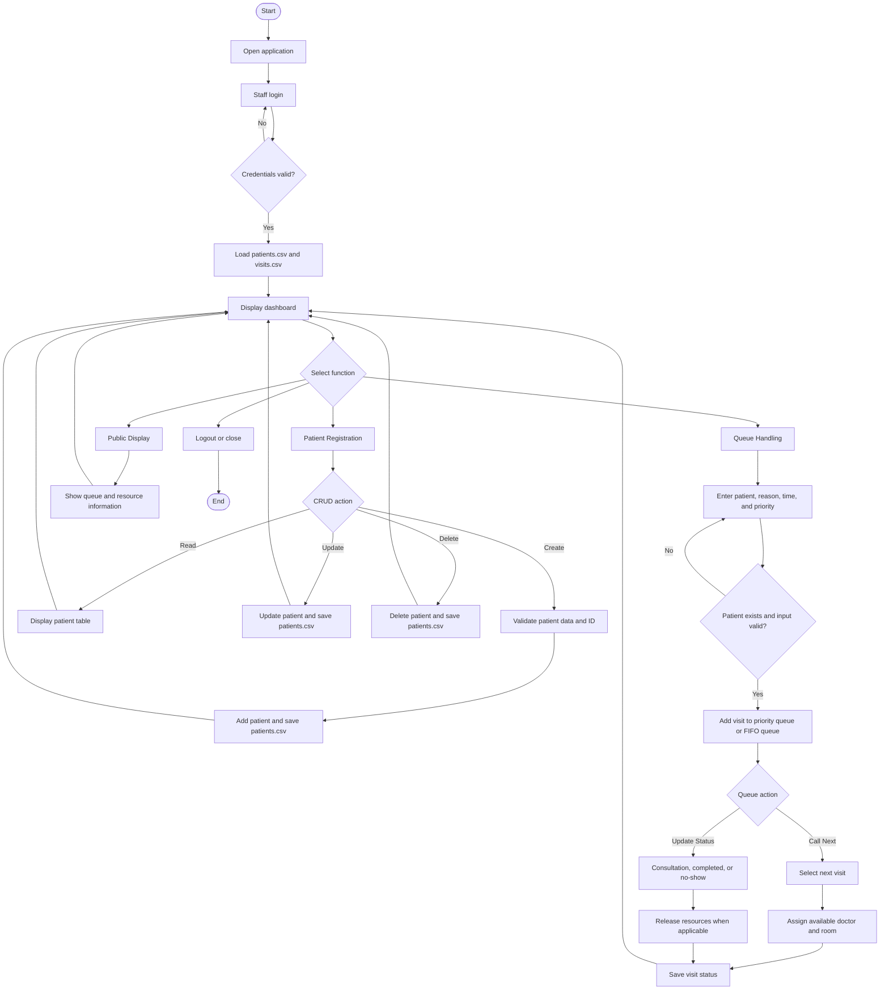

# Clinic Patient Queue Management System

## V. Project Documentation

### 1. Project Title

**Clinic Patient Queue Management System**

### 2. Introduction and Problem Description

Clinics need an organized way to register patients, manage waiting lines, prioritize urgent cases, and monitor consultation progress. Manual queue lists can cause delays, duplicate registrations, and difficulty identifying the next patient to be served.

The Clinic Patient Queue Management System is a Java Swing desktop application that provides a staff interface for patient registration and queue handling. It stores patient and visit records in CSV files so that information remains available after the application is closed and reopened.

### 3. General and Specific Objectives

#### General objective

To develop a desktop-based clinic queue management system that improves the organization and processing of patient visits.

#### Specific objectives

- Register and maintain patient records.
- Validate patient IDs and prevent duplicate patient registration.
- Create queue visits with a reason, scheduled time, and priority.
- Serve emergency and urgent cases before regular cases.
- Assign available doctors and rooms when a patient is called.
- Track waiting, called, consultation, completed, cancelled, and no-show visits.
- Save and reload patient and visit data using CSV files.
- Provide a read-only public display of queue information.
- Demonstrate searching, sorting, linked lists, queues, and priority queues.

### 4. Target Users or Client

The intended users are:

- **Clinic staff or receptionists** who register patients and add visits to the queue.
- **Nurses or clinic coordinators** who call patients, update visit status, and monitor resources.
- **Patients and visitors** who can view queue information through the public display.
- **Clinic administrators or instructors** who review the system’s data structures and algorithms.

### 5. System Features and Functionalities

#### Login

- Staff login is provided through the existing login window.
- Test credentials:
  - Staff ID: `STAFF-001`
  - Password: `admin123`

#### Dashboard

- Displays clinic overview information.
- Shows waiting visits, active consultations, available doctors, and available rooms.
- Provides navigation to the main system functions.

#### Patient registration and CRUD

- Create a patient record.
- Read and display patient records in a table.
- Update patient information.
- Delete a patient record.
- Select a table row to load its values into the form.
- Reject blank required fields and duplicate patient IDs.

#### Queue handling

- Register a visit for an existing patient.
- Select `EMERGENCY`, `URGENT`, or `REGULAR` priority.
- Record the visit reason and time in `HH:mm` format.
- Call the next patient according to priority and arrival order.
- Start consultation for a called patient.
- Mark visits as completed or no-show.
- Refresh the queue table.
- Assign an available doctor and room to a called patient.

#### Public display

- Opens a separate read-only window.
- Displays queue numbers, patient information, doctor and room assignments, and waiting count.

#### CSV persistence

- Patient records are stored in `data/patients.csv`.
- Visit records are stored in `data/visits.csv`.
- Data is loaded during startup and saved after successful CRUD or queue operations.
- The data directory can be selected with the `clinic.data.dir` Java system property.

### 6. Data Structures and Algorithms Used

#### Data structures

- `LinkedList<Patient>` for the patient collection.
- `PriorityQueue<Visit>` for emergency and urgent visits.
- `ArrayDeque<Visit>` for regular visits using FIFO ordering.
- `LinkedList<Visit>` for visit history.
- `ArrayList<Doctor>` for doctors.
- `ArrayList<Room>` for rooms.

#### Algorithms

- Linear search for patients, visits, doctors, and rooms.
- Binary search for finding a patient by ID.
- Iterative Quick Sort for sorted patient or visit views.
- Priority queue comparison using priority level and arrival time.
- FIFO queue processing for regular visits.

### 7. Explanation of Data Structure Implementation

#### Patient linked list

Patients are stored in a `LinkedList`. New patients are appended, and the list is traversed for linear searches. Updating and deleting a patient operate on the matching patient object, after which the complete patient list is written to the CSV file.

#### Priority queue

Emergency and urgent visits are placed in a `PriorityQueue`. Each visit has a numeric priority value: emergency is highest, urgent is next, and regular is lowest. Visits with the same priority are ordered by their arrival time.

#### Regular FIFO queue

Regular visits are stored in an `ArrayDeque`. The queue uses `offer` to add visits and removes the earliest waiting visit first, preserving first-in-first-out behavior.

#### Visit history

All visits are retained in a linked list so completed, cancelled, no-show, and waiting visits can be displayed together. The queue table uses a sorted copy of this history rather than changing the original record order.

#### Resource lists

Doctors and rooms are stored in `ArrayList` collections. A linear scan finds the first available doctor and room. Resources are marked unavailable when assigned and become available again when a visit is completed, cancelled, or marked no-show.

#### Searching and sorting

Patient lookup uses case-insensitive linear search by patient ID or name. Binary search creates a sorted copy of the patient list and searches that copy by ID. The service also implements iterative Quick Sort for displaying records in ticket or ID order.

### 8. System Flowchart



### 9. Screenshots of the GUI and Its Functions

The following screenshots should be captured from the running application in NetBeans and inserted in this section:

1. **Login screen** - staff ID and password fields.
2. **Dashboard** - clinic overview and navigation.
3. **Patient Registration** - patient form, table, and CRUD buttons.
4. **Queue Handling** - visit form, queue table, and status actions.
5. **Public Display** - read-only queue and resource display.

Suggested Markdown format after capturing the images:

```markdown


```

No GUI screenshots were available in the project workspace when this documentation was prepared, so the image links above are intentionally left as capture instructions rather than fabricated screenshots.

### 10. Testing Results

| Test area | Expected result | Result |
|---|---|---|
| Project compilation | All Java source files compile successfully | Passed |
| Login validation | Valid staff credentials open the clinic interface | To verify in NetBeans |
| Patient creation | A valid patient is added and persisted | To verify in the GUI |
| Duplicate patient ID | Duplicate IDs are rejected | Implemented; verify in the GUI |
| Patient update | Existing patient information is changed and saved | Implemented; verify in the GUI |
| Patient deletion | Existing patient is removed and saved | Implemented; verify in the GUI |
| Visit registration | Existing patients can be added to the queue | Implemented; verify in the GUI |
| Time validation | Invalid time formats are rejected | Implemented; verify in the GUI |
| Queue priority | Emergency and urgent visits precede regular visits | Implemented; verify in the GUI |
| FIFO behavior | Equal-priority regular visits retain arrival order | Implemented; verify in the GUI |
| Resource assignment | A called visit receives an available doctor and room | Implemented; verify in the GUI |
| CSV persistence | Records reload after restarting the application | Implemented; verify in NetBeans |
| Public display | Queue information is shown in a separate read-only window | Implemented; verify in the GUI |

The source compilation check was completed using:

```text
javac -d <output-folder> ClinicDSAProject\src\clinicdsaproject\*.java
```

The graphical interface should be tested in NetBeans because the GUI was not launched in the command-line validation environment.

### 11. Conclusion

The Clinic Patient Queue Management System provides a practical workflow for clinic patient registration and queue processing. It combines Java Swing user interfaces with linked lists, priority queues, FIFO queues, searching, sorting, and CSV persistence. The system addresses the main problems of manual queue management by organizing patient records, prioritizing urgent cases, assigning clinic resources, and preserving data between sessions.

Future improvements may include quoted CSV escaping, a database backend, persistent doctor and room assignments, appointment scheduling, user roles, and automated GUI tests.
